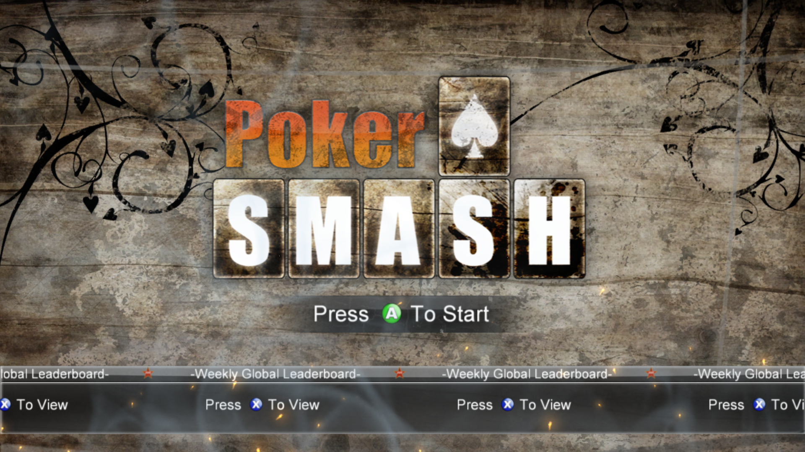

# Poker Smash — native Windows port (Xbox 360 → PC)

A from-scratch recompilation of the Xbox 360 XBLA title **Poker Smash**
(Title ID `5841089C`) into a native Windows executable, built with
[ReXGlue](https://github.com/rexglue/rexglue-sdk).

No emulator, no interpreter — the original PowerPC code is statically
translated to C++ and compiled to a normal `pokersmash.exe`. A separate
launcher GUI configures and starts it.



---

## What this repository contains

| | |
|---|---|
| Recompiled game source | `pokersmash/` — manifest, app shims |
| Launcher source | `pokersmash/src/launcher/` — Dear ImGui + SDL3 GUI |
| Build script | `build.ps1` |
| Documentation | `README.md` |

**No game assets and no prebuilt binaries are included.** You build everything
yourself — see [Building from source](#building-from-source). You must also own
a copy of Poker Smash and supply your own extracted game data. See
[Legal](#legal).

---

## Quick start

1. Clone this repository.
2. [Build it](#building-from-source) — this produces `pokersmash.exe` and
   `pokersmash_launcher.exe` plus the runtime DLLs.
3. Put your extracted game data in an `extracted/` folder **next to**
   `pokersmash_launcher.exe`. It must contain `default.xex` and the `Data/`
   folder.
4. Run `pokersmash_launcher.exe`.

```
build-output/
  pokersmash_launcher.exe   <- run this
  pokersmash.exe
  rexruntime.dll
  rexgpu-xenos.dll
  TracyClient.dll
  pokersmash.toml           (optional)
  extracted/                <- your game data goes here
    default.xex
    Data/
    file_bundle.bin
    ...
```

The launcher shows a status page confirming that the game executable, the game
data and the GPU plugin were all found. Press **PLAY** to start.

You can also run `pokersmash.exe` directly — it auto-detects the game data and
enables the GPU backend with no arguments at all.

---

## Getting the game data

You need a copy of Poker Smash for Xbox 360 and a way to extract it. This
repository does not provide, link to, or describe where to download the game.

The extraction step is the same as for any XBLA title:

1. Obtain the game package from your own copy (console, or a dump you made
   yourself).
2. Extract the STFS container. The `360tools` project used during development
   provides `extract_stfs.py`; any equivalent STFS extractor works.
3. The result should be a folder containing `default.xex` plus `Data/` and
   `file_bundle.bin`.

> **Note:** the original development package was the trial/PIRS variant, so the
> title screen shows a "Trial Version — Unlock Full Game" ribbon. That reflects
> the source package, not the recompilation. A full-game package works too, as
> long as it is the same build — see
> [Using a different game variant](#using-a-different-game-variant).

---

## Building from source

Requires:

- Visual Studio 2022 or newer (C++ workload)
- CMake 3.25 or newer
- Ninja
- Python 3

Run everything inside the VS developer shell so MSVC and the Windows SDK are on
`PATH`:

```powershell
& 'D:\Visual Studio\Common7\Tools\Launch-VsDevShell.ps1' -Arch amd64 -HostArch amd64
```

### 1. Get the game data first

Codegen reads `default.xex`, so the game data must be in place **before** you
build. Extract your game package into an `extracted/` folder next to the
`pokersmash/` project directory:

```
repo/
  pokersmash/
    pokersmash_manifest.toml   <- points at ../extracted/default.xex
    ...
  extracted/                   <- your game data goes here
    default.xex
    Data/
    file_bundle.bin
```

The manifest expects the game root at `../extracted` relative to
`pokersmash/`. If your data lives elsewhere, edit `game_root` and
`entrypoint.file_path` in `pokersmash_manifest.toml`.

### 2. Build and install the ReXGlue SDK

```powershell
git clone --recursive https://github.com/rexglue/rexglue-sdk
cd rexglue-sdk

cmake -B out/build/win-amd64 -G "Ninja Multi-Config" `
    -DCMAKE_INSTALL_PREFIX=out/install/win-amd64 `
    -DREXGLUE_USE_D3D12=ON `
    -DREXGLUE_USE_VULKAN=ON

cmake --build out/build/win-amd64 --config Release
cmake --install out/build/win-amd64 --config Release
```

- `REXGLUE_USE_VULKAN` is **off by default on Windows**. Enabling it adds the
  Vulkan backend to `rexgpu-xenos.dll` (which then grows from ~2.7 MB to
  ~5.9 MB). All Vulkan dependencies are vendored in the SDK, so no external
  Vulkan SDK is needed. Drop the flag for a Direct3D 12-only build.
- On Windows the SDK uses the system Vulkan loader
  (`C:\Windows\System32\vulkan-1.dll`); the vendored MoltenVK is only built on
  macOS.

### 3. Generate and build the project

```powershell
cd path\to\repo\pokersmash

rexglue codegen pokersmash_manifest.toml
cmake --preset win-amd64-release
cmake --build out/build/win-amd64-release
```

Codegen runs automatically as the first build step (it reads
`../extracted/default.xex` through the manifest), so the explicit
`rexglue codegen` line above is optional. To run codegen on its own:

```powershell
cmake --build out/build/win-amd64-release --target pokersmash_codegen
```

This produces, in `out/build/win-amd64-release/`:

- `pokersmash.exe` — the recompiled game
- `pokersmash_launcher.exe` — the launcher GUI
- `rexruntime.dll`, `rexgpu-xenos.dll`, `TracyClient.dll`

Or simply run `build.ps1` from the repository root, which does all of the above.

> **Note:** `rexglue codegen` returns exit code 1 even on success-like runs.
> Check the actual output, not the exit code.

---

## Using the launcher

The launcher has five pages:

### HOME

Shows whether the game executable, the game data and the GPU plugin were found,
plus the current configuration. Press **PLAY** to start the game.

### GRAPHICS

| Setting | Values | Notes |
|---|---|---|
| Graphics backend | Auto / Direct3D 12 / Vulkan | Direct3D 12 is the better-tested path. Auto tries Direct3D 12 first, then Vulkan. |
| Display mode | Windowed / Borderless / Fullscreen | |
| Render resolution | Auto / 720p / 1080p / 1440p / 2160p | Auto uses the window size. |
| VSync | On / Off | Off allows tearing for the lowest latency. |

### PERFORMANCE

| Setting | Values | Notes |
|---|---|---|
| Frame limit | Auto / 30 / 60 / 120 / Unlimited | The original game runs at 60. |
| Performance overlay | On / Off | Toggle in game with F3. |

### GAME

- **Game folder** — the folder containing `default.xex` and `Data/`. The
  launcher auto-detects candidates next to itself and lists them as one-click
  fills. Use **Browse...** for a native folder picker.
- **Game language**

### ADVANCED

- **Write a log file** — writes `pokersmash.log` next to the game.
- **Extra command line** — appended verbatim. A live command preview is shown
  below.

Settings are saved to `launcher.toml` next to the launcher when you press
**Save** or **PLAY**.

### Keyboard shortcuts

| Key | Action |
|---|---|
| Enter | Start the game |
| Escape | Close the launcher |

---

## Configuration without the launcher

`pokersmash.exe` works with no arguments at all. To override, create
`pokersmash.toml` next to the executable:

```toml
# Path to the folder containing default.xex and the Data/ directory.
game_data_root = "D:\\path\\to\\extracted"

# Graphics backend: "auto" (default), "d3d12", or "vulkan".
gpu_backend = "auto"
```

Or pass arguments directly:

```powershell
.\pokersmash.exe --game_data_root=D:\path\to\extracted --gpu_backend=vulkan
```

The game looks for its data in this order:

1. `--game_data_root` / the `game_data_root` cvar
2. `game_data_root` in `pokersmash.toml`
3. Auto-discovery: the first of `extracted/`, `game_data/`, `game/`, or the
   executable's own folder (and a few levels up) that contains `default.xex`

---

## How it works

| Stage | Tool | Result |
|-------|------|--------|
| Unpack the game package | `360tools/extract_stfs.py` | 322 files, 98 MB |
| Translate the XEX | `rexglue codegen` | ~17,500 recompiled functions |
| Compile | MSVC / CMake | `pokersmash.exe` |

The recompiler reads the game's exception directory (PDATA) to find function
boundaries. This title's PDATA is imprecise — lengths run past the next
function's start — which broke two things:

- **Build errors** from jump-table targets attributed to the wrong function.
- **Runtime traps** (`Call to invalid or unregistered function`) for small
  functions reachable only through vtables, which ended up inside a
  neighbouring function's scanned extent.

Both are fixed with explicit boundary overrides in
`pokersmash/pokersmash_manifest.toml` (47 entries).

Three runtime shims round it out:

- **VFS relative paths** (`src/pokersmash_app.h`) — the game opens content with
  bare paths like `data\textures\`, which the SDK VFS rejects. Symbolic links
  map the relative prefixes onto the mounted game partition.
- **XUsbcam stubs** (`src/stubs.cpp`) — the SDK's Vision Camera implementation
  isn't compiled into the runtime, so the imported `__imp__XUsbcam*` symbols are
  stubbed. The game links the camera library but never uses a camera.
- **Auto-configuration** (`src/pokersmash_app.h`) — game root discovery, GPU
  plugin selection, and backend fallback, so a plain double-click works.

### Launcher architecture

The launcher is a separate executable that links the same `rexruntime.dll` (for
the SDL3 window, the D3D12 presenter and the Dear ImGui layer) but takes no part
in codegen: no recompiled sources, no GPU plugin, no guest code. It is
configured with `rexglue_configure_target` rather than `rexglue_setup_target`,
which is what would pull in the generated code.

Pressing **PLAY** spawns `pokersmash.exe` as a child process with the chosen
arguments and closes the launcher.

---

## Using a different game variant

The executable does not check whether the game is the trial or the full
version — that decision comes entirely from the XEX that gets loaded. If you
substitute a different package, three things must match:

| | Value in this build |
|---|---|
| Title ID | `5841089C` |
| Base address | `0x82000000` |
| Function layout | 47 boundary overrides in the manifest |

If the package is the same build with a different license flag, everything
matches and it works immediately — just point the launcher at the new folder.

If it is a different build (newer version, patch, different region), function
addresses may shift and you will see `Call to invalid or unregistered function`
again. The fix is to re-run `rexglue codegen` against the new `default.xex` and
re-derive the boundary overrides.

---

## Status

Boots to the title screen and renders correctly — UI text, fonts, button
glyphs, background art, the leaderboard ticker, audio output, and controller
input all work. Both the Direct3D 12 and Vulkan backends have been verified.

This is the **trial** build of the game (the package is the PIRS/trial variant),
so the title screen shows the "Trial Version — Unlock Full Game" ribbon. That
reflects the source package, not the recompilation.

---

## Legal

This repository contains **no game assets or binaries from the original game**.
You must own a copy of Poker Smash and supply your own extracted game data.

What is here is the recompilation tooling, the manifest, the runtime shims, the
launcher, and the resulting host binaries — none of which contain copyrighted
game content. The recompiled code is a mechanical translation of the original
PowerPC instructions and is only useful together with game data you provide
yourself.
